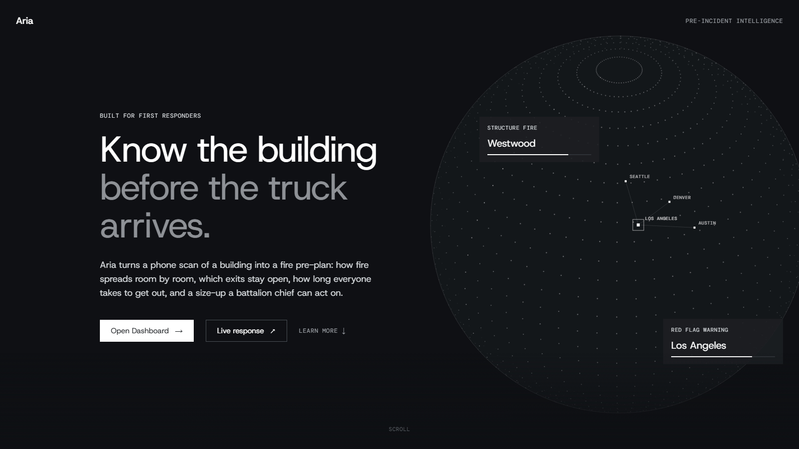
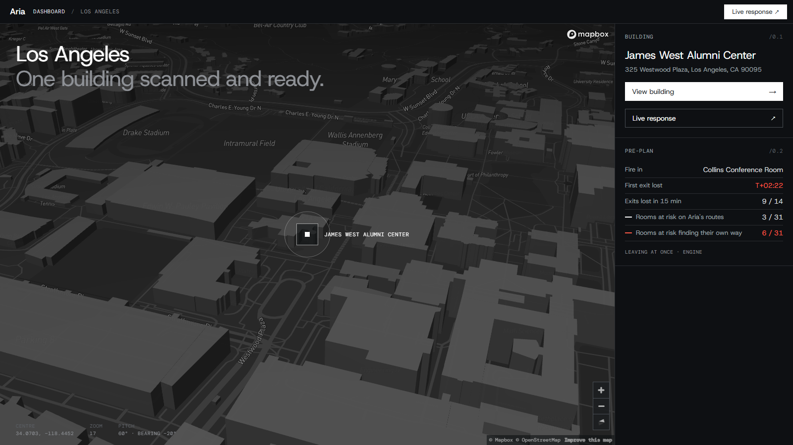
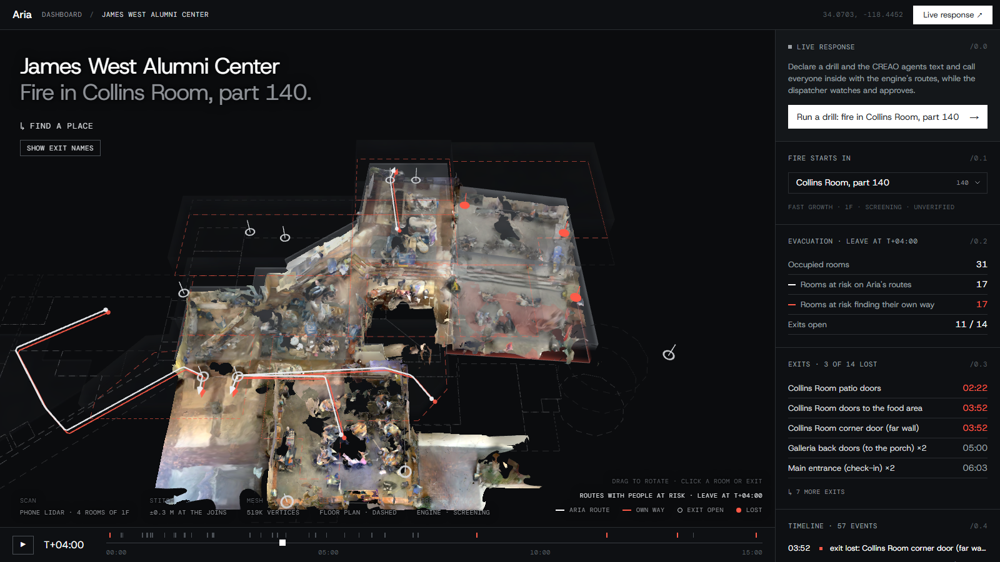
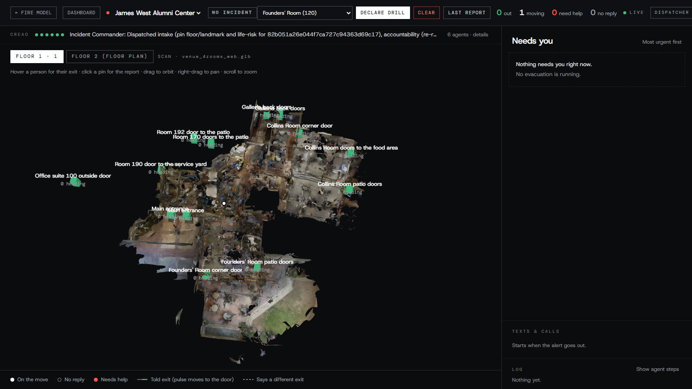
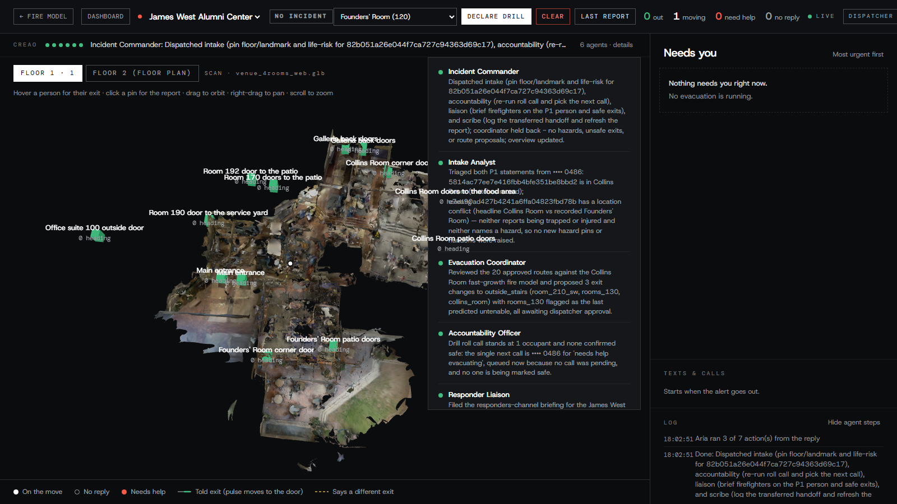

# Aria

Fire crews often arrive at a building they have never been inside, and the people inside get one
alarm and no idea which exit is still safe.

Aria turns a phone scan of a building into a fire pre-plan, then helps run the response when the
alarm goes. We scanned part of the James West Alumni Center at UCLA with a phone and joined the scans
to the building's fire plan to make one building model. Pick where a fire starts and Aria's engine
shows how smoke and fire spread, which exits are lost and when, and a route out for every occupied
room, with a size-up for responders. During a drill, six agents we built on CREAO
(agent.creao.ai) run the incident command: they read what callers and texters report, pin hazards, propose route changes, keep the roll call and
write the signed incident report. A dispatcher approves every route change before anyone is told.
People in the building get texts (Photon) and calls (an ElevenLabs voice agent).

Built at LA Hacks 2026 (Sat Oct 17 – Sun Oct 18) by Lincoln, Aayush Pal and Sai.

## For judges

- **Main track:** Applied Intelligence.
- **CREAO agent ID (Incident Commander):** `ef349685-a692-4a0d-ae20-eb2e1f524624`
  ([agent page](https://agent.creao.ai/install/ef349685-a692-4a0d-ae20-eb2e1f524624?version=092e0321-8250-43be-83dc-38e5ae9aa893)).
  The other five agents are in [The agents](#the-agents).
- **CREAO run share link (Incident Commander):** https://agent.creao.ai/share/46bf0fc2477da75e00d139e9eafbfb0e
  (Aria run id `fb19956e68d744059d8773a3c300a26e`, Sun Oct 18)
- **What the CREAO agents do:** they run the incident command during a drill. See [CREAO](#creao).
- **Demo video:** VIDEO_LINK_HERE
- **Built at the event:** [Built at LA Hacks](#built-at-la-hacks).
- **Sponsor tech:** [Sentry](#sentry), [TigerData](#tigerdata), [Photon](#photon), [ElevenLabs](#elevenlabs).

## Live links

| What | Link |
|---|---|
| Demo video | VIDEO_LINK_HERE |
| Web app | https://aria-lahacks.vercel.app |
| Venue on the map | https://aria-lahacks.vercel.app/dashboard |
| Building page (scan, fire start, size-up) | https://aria-lahacks.vercel.app/building/547b5ec5-30c5-4f76-8080-012a52e90bd9 |
| Live dispatcher console (CREAO staff) | https://aria-lahacks.vercel.app/live/view |
| API health | https://aria-lahacks-production.up.railway.app/health |
| Live layer health (TigerData, CREAO staff) | https://aria-lahacks-production.up.railway.app/live/health |

The console opens with no login. Please look around, but don't press **Declare drill**: a drill
texts and calls our team's phones.

## Screenshots

**Landing page**



**The venue on the map, with the engine's pre-plan**



**Building page: the phone scan on the floor plan, a fire in the Collins Room, smoke, lost exits and routes**



**Live dispatcher console, with the CREAO staff strip at the top**



**The six CREAO agents' latest work and their steps in the log**



## Demo flow

1. **Scan.** Phone LiDAR scans of the venue plus its fire plan become one building model,
   `packages/engine/venue.json`: 63 spaces, 99 openings, 14 exits.
2. **Fire start.** On the building page, pick where the fire starts (or search for a place).
3. **Engine.** The engine works out how smoke fills each room, which exits are lost and when, and
   a capacity-aware route out for every occupied room, compared with the way people would pick
   themselves. The scan shows it on a fire clock you can scrub, and the size-up panel sums it up
   for responders.
4. **Declare a drill** on the live console. The console shows the same fire model.
5. **CREAO staff, texts and calls.** The messenger texts the people who registered, and calls
   those who ask for a call or don't reply. Every text and call line lands in TigerData; reports of trouble, hazards and
   handoffs wake the CREAO Incident Commander, who hands work to five specialists.
6. **Dispatcher approves.** Route changes the agents propose wait in **Needs you**. Approve one
   and the people in that zone get the new route by text. Ending the drill clears the console,
   and the CREAO Incident Scribe writes the after-action report.

## CREAO

**The CREAO agents do the core work of the live response.** Six agents we built on
[agent.creao.ai](https://agent.creao.ai) form the incident command staff. During a drill they:

- triage what callers and texters say, and flag anyone who may be trapped or hurt
- pin hazards on the map
- propose route changes, which the dispatcher approves or rejects
- run the roll call and request calls to people who haven't answered
- brief arriving fire crews
- keep the signed live incident report, and write the after-action report when the drill ends

The engine computes fire, smoke and routes; the CREAO staff run the incident command on top of it.
CREAO never messages anyone directly: texts and calls go out through the messenger, and route
changes only after the dispatcher approves them.

### How the agents are triggered

1. Every event (drill declared, a text, a call line, a hazard, a handoff) is written to TigerData,
   and streamed with `pg_notify` (a trigger on each inserted row; the API publishes its own
   decisions the same way).
2. The API's orchestrator (`apps/api/app/creao/bridge.py`) hears it on LISTEN, batches routine
   events (`CREAO_DEBOUNCE_SECS`; a declared drill or a handoff goes at once) and starts the
   Incident Commander through its **CREAO API Trigger**:
   `POST https://agent.creao.ai/api/v1/apps/{agent id}/runs`. The run's inputs carry the new
   events, a snapshot of the situation read from TigerData, and a webhook back to the API.
3. The Commander's handoffs start the specialists' runs the same way.
4. Each agent ends its reply with an `aria-actions` block (a JSON list of tool calls). CREAO
   can't attach a custom MCP connector, so the actions ride in the reply. When CREAO calls
   `POST /live/creao/run-result`, the API runs them through the same tool functions that `/mcp`
   serves, safety rules first, at most 12 per run: `handoff_to_agent`, `propose_route`,
   `report_hazard`, `request_call`, `request_handoff`, `update_report`, `add_note`,
   `complete_task`.

`GET /live/buildings/{id}/staff` lists every run and action. As of 11:05 AM PDT on Sun Oct 18 it
listed 66 CREAO runs across the six agents.

### The agents

The agent ID is the id in each agent's `/install/<id>` link; the API uses it for that agent's API
Trigger (`CREAO_APP_<ROLE>`).

| Role | What it does | Agent ID | Public link |
|---|---|---|---|
| Incident Commander | Reads every new event, hands each task to a specialist, keeps the report's overview | `ef349685-a692-4a0d-ae20-eb2e1f524624` | [Aria · Incident Commander](https://agent.creao.ai/install/ef349685-a692-4a0d-ae20-eb2e1f524624?version=092e0321-8250-43be-83dc-38e5ae9aa893) |
| Intake Analyst | Turns texts and call lines into hazards; flags people who may be trapped or hurt | `113efaf2-fd95-4ca2-9e84-3f3481309423` | [Aria · Intake Analyst](https://agent.creao.ai/install/113efaf2-fd95-4ca2-9e84-3f3481309423?version=dfe9624c-ab7e-4c35-9b4e-478429eeb9cd) |
| Evacuation Coordinator | Checks each zone's exit against hazards and the fire model; proposes route changes | `e433f077-c48d-4080-8d6f-4ff771633c06` | [Aria · Evacuation Coordinator](https://agent.creao.ai/install/e433f077-c48d-4080-8d6f-4ff771633c06?version=9b0e6560-468d-46f7-9a1a-cb89bf4d841b) |
| Accountability Officer | Keeps the roll call and picks who to call next | `2d6f125c-13a4-4872-a54d-0471491485f8` | [Aria · Accountability Officer](https://agent.creao.ai/install/2d6f125c-13a4-4872-a54d-0471491485f8?version=81c53a6e-fe89-4e14-90a0-8b0b547c2aaf) |
| Responder Liaison | Writes the briefing for arriving fire crews | `20ca703a-c164-48af-8752-69887706dd04` | [Aria · Responder Liaison](https://agent.creao.ai/install/20ca703a-c164-48af-8752-69887706dd04?version=e4037f5d-ed3d-4dbf-a448-a20cf6e4411d) |
| Incident Scribe | Keeps the timeline; writes the after-action report when a drill ends | `db6d854b-42ed-4df9-be21-90131c53ec3e` | [Aria · Incident Scribe](https://agent.creao.ai/install/db6d854b-42ed-4df9-be21-90131c53ec3e?version=473d1852-0321-46ff-8e91-8d1118848784) |

The Incident Commander's run share link and run id are at the top, in [For judges](#for-judges).

### Where to see the agents run

On the live console, `/live/view`:

- **The CREAO strip** at the top: six status dots and the Incident Commander's latest step.
  **6 agents · details** opens each agent's latest work.
- **Show agent steps** in the log: lines such as "Started in CREAO (run id)" and "Aria ran N of M
  action(s) from the reply". The run id matches the run on agent.creao.ai.
- **Click a pin:** the **CREAO incident report** drawer, with staff notes, agent actions and the
  report sections each agent signed.
- **Needs you:** route-change cards marked "Proposed by the coordinator", with Approve and Reject.
- **End the drill:** the **CREAO after-action report**, written by the Incident Scribe.

Signed sections appear while a drill runs. With no drill running, report sections read
"automatic". Agent instructions and the full contract: [`docs/creao-layer.md`](docs/creao-layer.md).

## Architecture

```
 Phone LiDAR scans (Polycam) + the building's fire plan
                 │
                 ▼
 packages/engine   venue.json → fire and smoke → exits lost → routes → size-up
                 │ (runs inside the API)
                 ▼
 apps/api  FastAPI on Railway ── /engine/* ──────────► apps/web  Next.js on Vercel
   │  /live/*, /mcp, console /live/view ◄── /live proxy ─┘  map, 3D scan, size-up
   │                                                        (Supabase: venue row + scan file)
   ▼
 TigerData (Timescale): hypertables, continuous aggregates, pg_notify triggers
   │ LISTEN
   ▼
 CREAO orchestrator (bridge.py) ── API Trigger ──► agent.creao.ai
   ▲                                                Incident Commander → 5 specialists
   └──── POST /live/creao/run-result ◄─────────── reply with an aria-actions block
   │
   ▼ live stream                          ▲ /live/intake/events (texts, call lines)
 apps/messenger  Photon texts + ElevenLabs voice calls ──► people in the building
                                          (trigger words hand a call to the dispatcher)
```

**Stack:** Next.js 16, React 19, Tailwind 4, Three.js, Mapbox GL (web, Vercel) · FastAPI, Python
3.12 (API, Railway, Docker) · the engine in plain Python (`packages/engine`) · TigerData
(Timescale/Postgres) for live events · CREAO agents · Photon and ElevenLabs (messenger, Node) ·
Supabase (venue row and scan storage) · Sentry (web and API) · Playwright.

## Built at LA Hacks

Hacking started Sat Oct 17 at 12:00 PM PDT. The first commit in this repo is Sat 1:37 PM.

**Built at the event**

- **The engine** (`packages/engine`), all of it: the venue model of James West from our scans and
  the fire plan, fire and smoke over time, flashover, exits lost over time, capacity-aware
  evacuation routes and the responder size-up. Served by `/engine/*` on the API.
- **The scan:** phone scans of four first-floor rooms, joined into one model and fitted to the
  floor plan; the rest of the building read from its fire plan.
- **The web app's fire features:** fire-start picker, place search, fire timeline with smoke, lost
  exits and routes on the scan, the size-up panel, the live response card, the `/live` proxy to the
  console, the restyle, and the Playwright smoke tests for the landing page, dashboard, building
  page and live console (the Playwright setup and a first building-page spec came from before the
  event).
- **The CREAO live layer:** the six CREAO agents on agent.creao.ai (instructions in
  `docs/creao-layer.md`), and in `apps/api/app/creao/` the orchestrator, the
  `/mcp` tools, the safety rules, the dispatcher console, the live and after-action reports.
- **TigerData:** the live event store with hypertables, continuous aggregates and LISTEN/NOTIFY.
- **The messenger** (`apps/messenger`): Photon texts and ElevenLabs voice calls that carry the
  dispatcher-approved routes.
- **Sentry** on the web app and the API; a new Supabase project; the Vercel and Railway deploys.

**From before the event** (Aria, our earlier project, Oct 6 2026)

- The Next.js shell, the landing page and its globe, the Mapbox dashboard, a basic Three.js scan
  viewer, the FastAPI skeleton with `/health`, and three Supabase migrations (`0001`, `0002`,
  `0004`).
- That project's flood agent and flood UI were deleted at the event and are not part of this
  submission.

## Sponsor tech

### CREAO

Six agents run the live incident command. See [CREAO](#creao) above.

### Sentry

Two projects, `aria-web` (Next.js on Vercel) and `aria-api` (FastAPI on Railway, which also runs
the engine and the CREAO live layer). Beyond errors we use:

- **Tracing:** browser → Vercel → API at 100%, with `sentry-trace` and `baggage` passed to the API.
- **Session Replay:** every session on the web app.
- **Logs:** the API's Python logging goes to Sentry Logs.
- **Profiling:** continuous profiling on the API, including the engine routes.

Browser events go through our own `/aria-relay` tunnel so ad blockers don't drop them. Moments
from the build:

- **Logs:** `TigerData LISTEN dropped (parameter "ssl" cannot be changed now)` repeated 832 times
  in 33 minutes early Sunday, so no database event reached the CREAO staff. Fixed in `6aa8385`
  (`sslmode` instead of `ssl`); the last warning in Sentry is at 3:37 AM.
- **Session Replay + Errors:** ARIA-WEB-6 to ARIA-WEB-A, five errors in 44 seconds while we moved
  the fire-start picker and timeline out of the scan during the restyle, with a replay. The move
  was finished in `e94f964` and none has come back.
- **Session Replay:** ARIA-WEB-3, the place search crashed on its first submit; fixed in
  `67ab53c`. ARIA-WEB-4, the building page failed to compile 12 times; fixed in `311bf95`.
- **Tracing:** the console's situation call runs up to 15 database queries one after another on
  Railway (about 2.2 s at p95). Found Sunday morning; not fixed before the code freeze.

### TigerData

The live layer's database (`apps/api/app/creao/timescale.py`, `hub.py`): hypertables for comms,
incident and evacuation events; continuous aggregates `evac_flow_15s` and `comms_1m`, which the
after-action report reads; `pg_notify` triggers on every insert. The API listens and streams each
event to the console and the messenger, and it is what wakes the CREAO staff.

### Photon

The messenger texts people in the building over a Photon iMessage line (`@photon-ai/api`). A shared
iMessage line can't send the first message, so each person texts the line once to register. During
a drill they get the alert, and each reply gets the dispatcher-approved instruction back. Replying
CALL starts an ElevenLabs voice call on the Photon voice number. The agents only propose routes; a
dispatcher approves each one before it is sent. If the ElevenLabs agent fails, the messenger sends
Aria's approved instruction or a canned line, tagged `fallback` in TigerData. Every text goes to the
live layer.

### ElevenLabs

A voice agent (ConvAI) calls people who ask for a call, and people the CREAO staff ask Aria to
call. It gives the dispatcher-approved route for where the caller says they are, and
on trigger words it hands the call to the dispatcher (`transfer_to_number`). Transcripts go to
TigerData. The same agent, in chat mode, writes the replies to texts, with the venue layout and a
knowledge base (`apps/messenger/knowledge/`).

## Team

- **Lincoln:** the engine, the scan and floor plan, the web app, and wiring the live layer to the
  engine.
- **Aayush Pal:** the CREAO live layer and the six agents, the API, TigerData.
- **Sai:** the messenger (Photon texts, ElevenLabs calls), plus the engine's first fire timeline
  and the viewer's first fire layer.

## Repository layout

```
apps/
  web/         Next.js 16 frontend: dashboard, building page, 3D scan viewer      → Vercel
  api/         FastAPI: the engine on demand (/engine/*) and the live layer (/live/*, /mcp)  → Railway
  messenger/   Texts (Photon) and voice calls (ElevenLabs) for people in the building; runs on a teammate's machine
packages/
  engine/      The building engine: venue model, fire and smoke, exits, routes (stdlib Python)
infra/
  supabase/    Postgres schema and the venue row (see infra/supabase/README.md)
docs/          Design notes; the live layer is in docs/creao-layer.md; screenshots in docs/img/
```

## Prerequisites

- Node.js 20+ and [pnpm](https://pnpm.io) 10
- Python 3.12 and [uv](https://docs.astral.sh/uv/)
- A Supabase project (venue row and scan storage) and a Mapbox token
- For the live layer: a Postgres database (TigerData) and a CREAO account with the six agents
  (agent.creao.ai); for the messenger, Photon and ElevenLabs accounts

## Setup

```bash
# Frontend
cd apps/web
cp .env.example .env.local      # fill in values
pnpm install

# API
cd ../api
cp .env.example .env            # fill in values
uv sync

# Messenger (optional; see apps/messenger/README.md)
cd ../messenger
cp .env.example .env
npm install
```

Careful: with a real `apps/api/.env`, a local API connects to the shared live database and,
through the messenger, to real texting and calling. Leave `CREAO_DATABASE_URL` empty (a local
SQLite file) when you only want to try things.

### Database (Supabase)

See [`infra/supabase/README.md`](infra/supabase/README.md): run migrations `0001`, `0002`,
`0004` and `0005` (the venue row), create the public `scans` bucket and upload the mesh.

### Environment variables

| App | Variable | Required | Purpose |
|---|---|---|---|
| web | `NEXT_PUBLIC_API_URL` | yes | Base URL of the API (the web app proxies `/engine/*` and `/live/*` to it, in dev and on Vercel) |
| web | `NEXT_PUBLIC_SUPABASE_URL` | yes | Supabase project URL (also used for Storage scan URLs) |
| web | `NEXT_PUBLIC_SUPABASE_ANON_KEY` | yes | Supabase publishable (anon) key |
| web | `NEXT_PUBLIC_MAPBOX_TOKEN` | yes | Mapbox public token for the dashboard map |
| web | `NEXT_PUBLIC_VENUE_BUILDING_ID` | yes | Supabase id of the venue row (`547b5ec5-30c5-4f76-8080-012a52e90bd9`) |
| web | `NEXT_PUBLIC_SENTRY_DSN`, `NEXT_PUBLIC_SENTRY_ENVIRONMENT` | no | Sentry for the web app |
| api | `CREAO_DATABASE_URL` | for live data | TigerData/Postgres URL; empty means a local SQLite file |
| api | `DISPATCH_API_KEYS` | for live mode | Dispatcher keys (`Authorization: Bearer`), comma-separated. Drills need no key; live mode, and full (unmasked) phone numbers and names, do |
| api | `CREAO_TOOL_SECRET` | for the messenger | Shared secret the messenger and ElevenLabs tools send as `X-Tool-Secret` |
| api | `CREAO_API_KEY`, `CREAO_APP_*` (six agent ids), `CREAO_WEBHOOK_TOKEN`, `PUBLIC_BASE_URL`, `CREAO_DEFAULT_BUILDING_ID`, `CREAO_DEBOUNCE_SECS` | for the CREAO staff | See `apps/api/.env.example` and `docs/creao-layer.md` |
| api | `MCP_API_KEYS` | no | Bearer tokens for `/mcp` (the local CREAO stand-in or another MCP client; the CREAO agents act through their reply instead) |
| api | `DISPATCHER_PHONE` | for handoffs | Number a caller is handed to when the dispatcher presses Join call (E.164) |
| api | `ALLOWED_ORIGINS` | no | Extra CORS origins, comma-separated |
| api | `SENTRY_DSN`, `SENTRY_ENVIRONMENT` | no | Sentry for the API |
| messenger | `PHOTON_PROJECT_ID`, `PHOTON_API_KEY` | yes | Texting (Photon) |
| messenger | `ELEVENLABS_API_KEY`, `ELEVENLABS_AGENT_ID`, `ELEVENLABS_PHONE_NUMBER_ID` | for calls | Voice agent (ElevenLabs) |
| messenger | `ARIA_LIVE_URL`, `ARIA_TOOL_SECRET`, `ARIA_BUILDING_ID`, `ARIA_PUBLIC_URL` | to join the live layer | The API's URL, its `CREAO_TOOL_SECRET`, the venue id, the API's public URL |
| messenger | `DISPATCHER_PHONE` | no | Number calls are handed to |

The committed `.env.example` files list the same variables with no values. Secrets go only in
the git-ignored env files.

## Running it

From the repo root:

| Command | What it does |
|---|---|
| `pnpm dev` | Frontend on :3000 and API on :8000 together (needs a bash shell for `apps/api/dev.sh`) |
| `pnpm check` | Lint, format check, typecheck and unit tests for web and API |
| `pnpm format` | Auto-format both apps (Prettier + ruff) |

Per piece:

| Piece | Commands |
|---|---|
| `apps/web` | `pnpm dev`, `pnpm build`, `pnpm lint`, `pnpm typecheck`, `pnpm test`, `pnpm test:e2e` |
| `apps/api` | `./dev.sh` (uvicorn with reload on :8000), `uv run ruff check .`, `uv run pytest` |
| `packages/engine` | `uv run python -m engine.demo --start 140 --summary`, `uv run pytest -q` |
| `apps/messenger` | `npm run start`, `npm run agent:sync` (see its README) |

### Engine endpoints

| Endpoint | Returns |
|---|---|
| `GET /engine/starts` | Default start, growth rates, every space a fire can start in |
| `GET /engine/viewer?start=140&growth=fast` | The viewer block (fire timeline and routes) drawn on the scan |
| `GET /engine/summary?start=140&growth=fast` | Scenario, summary, exits, origin and the responder size-up |

The live layer's endpoints (`/live/*`, the console at `/live/view`, `/mcp`) are documented in
[`docs/creao-layer.md`](docs/creao-layer.md).

## Testing

- **Engine:** `packages/engine/tests/`: physics, venue, routes, demo and place lookup.
- **API:** `apps/api/tests/`: HTTP smoke tests (no lifespan, no network) and the live layer's rules.
- **Web:** `apps/web/lib/*.test.ts` with Node's test runner via `tsx`.
- **End to end:** `apps/web/tests/e2e/` (Playwright): landing, dashboard, building page and the
  live console. `pnpm --dir apps/web test:e2e` runs it against `pnpm dev` on :3000. Against the
  deployed site:

  ```bash
  cd apps/web && E2E_BASE_URL=https://aria-lahacks.vercel.app npx playwright test
  ```

  The live console spec is read-only: it never declares or ends a drill (it blocks those
  requests).

## Deployment

| Piece | Host | Root directory |
|---|---|---|
| Frontend (Next.js) | Vercel | `apps/web` |
| API (FastAPI + engine + live layer) | Railway (Dockerfile) | repo root (blank) |
| Messenger | A teammate's machine (Photon + ElevenLabs) | `apps/messenger` |
| Venue row + scan storage | Supabase | — |
| Live data | TigerData | — |
| Agents | CREAO (agent.creao.ai) | — |

Deploy the API first so you have its URL for the frontend and the messenger.

1. **API → Railway:** New Project → Deploy from GitHub repo → this repo. Leave **Root
   Directory** blank (the repo root), so the image also gets `packages/engine`; the root
   `railway.toml` points the build at `apps/api/Dockerfile`. Add the API variables, then
   **Settings → Networking → Generate Domain**. `GET <url>/health` should return
   `{"ok": true}` and `GET <url>/engine/starts` the list of starts. CORS always allows
   `http://localhost:3000` and any `*.vercel.app` origin; add others with `ALLOWED_ORIGINS`.
2. **Frontend → Vercel:** import this repo, **Root Directory** `apps/web`. Add the web
   variables, with `NEXT_PUBLIC_API_URL` set to the Railway URL, then deploy.
3. **Supabase:** see Database above.
4. **Messenger:** set `ARIA_LIVE_URL`, `ARIA_TOOL_SECRET` and `ARIA_PUBLIC_URL` to the Railway
   API and run it (see `apps/messenger/README.md`).

Smoke test: `/` loads, `/dashboard` shows the venue marker, the building page shows the scan,
and picking a fire start redraws smoke, lost exits and routes from `/engine`. If nothing
redraws, `NEXT_PUBLIC_API_URL` is wrong or the API is down. `/live/view` opens with no login and
shows Declare drill (don't press it on the live site: it texts and calls real phones).

## License

MIT. See [`LICENSE`](LICENSE).
