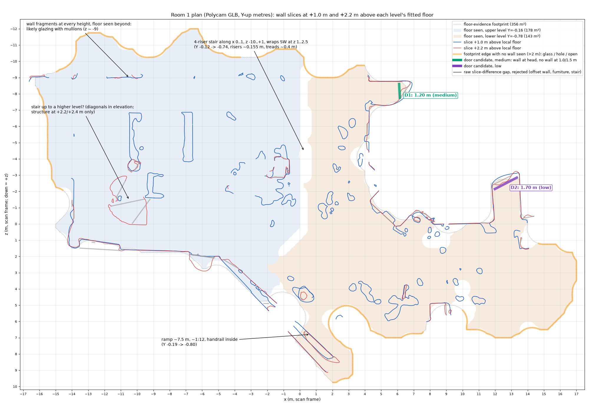
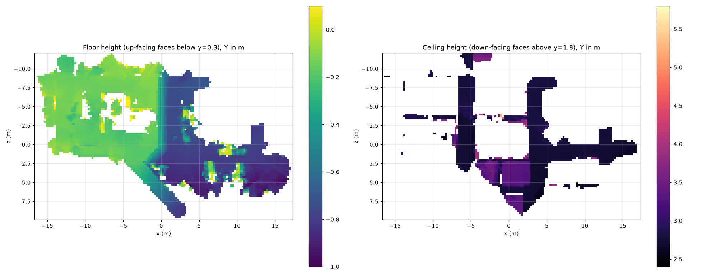

# 10: First room scan: what it shows

Polycam export `10_17_2026.glb`, Sat Oct 17 ~6:50 PM. It was probed in a throwaway Python environment (trimesh + shapely), following section 2.1 of `09-engine-research.md`; nothing went into the repo but this doc and two images.





## The file

- **Format:** 13.75 MB GLB in plain glTF 2.0, with no Draco, KTX2 or meshopt compression. It is made of 5 meshes, about 140k vertices and 223k triangles, with 5 embedded JPEG textures (9.6 MB). Y is up and units are metres.
- **Bounds:** 33.6 × 21.7 m in plan and 6.75 m tall. The plan coordinates are the scan's x and z.
- **Viewer:** three.js GLTFLoader loads it as-is. Supabase Free allows 50 MB per file, so it fits.

## The space

It isn't one simple room.

- **Two floor levels:**
  - Upper (west): Y −0.155, about 178 m² seen.
  - Lower (east): Y −0.778, about 143 m² seen.
  - The difference is 0.62 m. Plane fits are within 3–4 cm.
- **Stair between the levels:** 4 risers at x 0..1, z −10..+1, each about 0.155 m high with treads about 0.4 m. The mesh smooths the steps into a slope, so they only show in height profiles.
- **Ramp:** from about (−2.5, 2.5) down to (2.5, 9.5). It is about 7.5 m long, about 1.5 m wide and falls about 0.6 m (roughly 1:12), with a handrail. It is the accessible route between the levels.
- **Possible stair to a higher level** at x −11..−7, z −3..0. Not confirmed.
- **Ceiling:** mostly at Y 2.75 (2.9 m above the upper floor, 3.5 m above the lower). The part over the upper-level west half was never captured; walls there reach Y 5.7, so it may be double height. That matters for smoke-layer height.
- **Footprint:** about 356 m² from floor evidence.

## Doors

Only two door candidates survived review out of 35 raw gaps; 33 were furniture, offset walls or the stair.

| | Where (x, z) | Width | Confidence |
|---|---|---|---|
| D1 | 6.1, −8.2 (east end of the small NE alcove, lower level) | 1.2 m ± 0.15 | Medium: the wall over the head is clear, the opening below is filled in |
| D2 | 11.9..13.6, −2.5 (north end of a 1.7 m corridor, lower level) | 1.7 m | Low: could be a double door, an opening or a scan hole |

**Tape-measure both, and note which openings are real exits.** The scan can't tell an exit from a hole.

## Lessons for the engine (world model)

- **Floor levels:** one storey per floor level is required. "Floor + 1.0 m" taken on one level lands mid-wall on the other. Slice parallel to each level's fitted floor, and clip each level's linework to its own floor region.
- **Doorways are filled in:** Polycam fills doorways and glass, so a doorway is not an empty gap at 1.0 m. The usable cue is a straight wall at head height (2.0–2.4 m) with the surface below bowing away from it. Better still, take doors from the plan (or a RoomPlan export) and use the scan only to measure widths where a head line exists.
- **Furniture clutters low slices:** 1.5 m is the cleanest wall height. Tables and chairs fill the 0.4–1.0 m slices.
- **Unknown boundary, not open boundary:** only 48% of the footprint boundary has walls captured. Unseen stretches (glass, holes) must be marked "unknown", never "open", or routing will invent phantom exits. Gate on this coverage figure before building the graph.
- **Stairs and the ramp need their own detection.** Model them as graph edges with speed and capacity penalties.
- **Glass:** probably along the north side at z ≈ −9. Floor scanned through glass inflates the footprint, so clip it with the plan's walls once aligned.

## Next scans

- **Doors and doorways:**
  - Prop doors open. A closed door reads as wall.
  - Scan each doorway head-on from both sides, and tilt up to catch the wall above it.
- **Walls, glass and ceiling:**
  - Walk the full perimeter 1–2 m from the walls, and reach behind furniture.
  - Mark glass by hand with a photo and a note.
  - Sweep the ceiling. Coverage was under half.
- **Drift and overlap:**
  - End each scan where it started to limit drift. This one tilts 0.2–0.56°.
  - Keep neighbouring scans overlapping at doorways so they can be aligned.
- **Exports:** export at full detail. Also export Room mode (RoomPlan/USDZ) if available, since it labels doors and windows.

## Showing it in the viewer

No code change is needed. The building page passes the database's `scan_url` to `BuildingScan`, which uses it for any building not in its hardcoded `SCANS` map (`BuildingScan.tsx:83`), and the venue isn't in that map.

1. **Upload:** put the GLB in the public `scans` bucket at a lowercase path ending in `.glb`, e.g. `james_west/room_1.glb`. The loader picks GLTF over USDZ by the `.glb` ending.
2. **Point the venue at it:**
   ```sql
   update buildings set scan_url = 'https://sntyqjzoyjfgrjesguvs.supabase.co/storage/v1/object/public/scans/james_west/room_1.glb'
   where id = '547b5ec5-30c5-4f76-8080-012a52e90bd9';
   ```
3. **Check:** open `/building/547b5ec5-30c5-4f76-8080-012a52e90bd9`. EVAC stays greyed out until the venue has route data, and hazard pins only appear after an agent run.
4. **Camera, if the framing looks off:** the auto-fit uses the 33.6 m dimension, so the camera stays 14 m or more away and sits low. Raise the `cinematic` vector's y (`BuildingScan.tsx:239`) or lower `minDistance` (line 246) to zoom inside.
5. **Before the report switches to fire:** `pinsFromReport` in `lib/scan-hazard-pins.ts` reads `report.hazards.wind/surge/flood`, so it will throw on a fire report unless it is updated alongside the schema.
