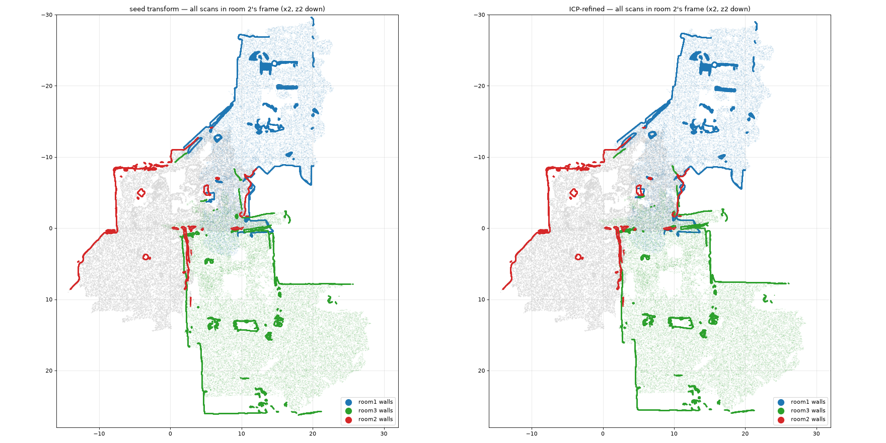

# 11: The venue plan and the first three scans

Sat Oct 17, evening. The inputs:
- **Three Polycam room scans.** None are uploaded yet; the GLBs are in Lincoln's Downloads.
- **The fire alarm annunciator photo** (`img/plan_fire_annunciator.jpg`).
- **The LA Hacks event map** (`img/plan_lahacks_event_map.png`).

The analysis ran in a throwaway Python environment. Nothing in the repo changed except this doc, `venue-plan-inventory.json` and three images. Room 1's details are in `10-scan-room1.md`.

## Summary

- **The scans, all ground floor:**
  - Room 1: the far end of the Galleria, with the 4-riser step, the ramp and stair 100ST.
  - Room 2: lobby 110 with the YOU ARE HERE panel, plus Entrance & Check-in.
  - Room 3: the Founders' Room (120) plus the Founders' Patio.
  - All three meet beside the restroom core.
- **They can be stitched into one frame** (transforms below, about ±0.3 m near the junction). That's the start of a single venue model.
- **The plan inventory** is in [`venue-plan-inventory.json`](venue-plan-inventory.json):
  - 1st floor: 38 spaces, 29 doors or openings, 7 stairs, 12 exits to outside.
  - 2nd floor: 22 spaces, 13 openings, 4 stairs, 2 exits.
  - 3rd floor: room 330.
  - It was extracted from the photos and checked by a second, independent reader. Positions are in photo pixels, about ±1–2 m.
- **Event names to room numbers:**

  | Event map | Annunciator |
  |---|---|
  | Collins Room | 140 + 150 |
  | Collins Patio | the SW courtyard |
  | Galleria | 110 + the corridor and its far end |
  | Founders' Room | 120 |
  | Founders' Patio | the north courtyard |
  | Restrooms | core 121/131 |
  | Stairs to the 2nd floor | the west exterior stair |
- **North is not settled.** The annunciator's compass is ambiguous; take a phone-compass reading at the panel.
- **What matters for fire:**
  - 110 and the Galleria's far end sit under open-to-below skylight wells shared with the 2nd floor. Smoke there reaches the 2nd floor directly, so stair 100ST is not a protected exit.
  - The scans contradict the plan in places, for example the Founders' opening and the Collins-side wall; see the last section.

All three scans are on the ground floor and meet at one spot: the strip of lobby 110 beside the restroom core, where the ANN corridor (the corridor with the YOU ARE HERE alarm panel) and the opening into the Founders' Room are.

Room 1 had no textured views, so I rendered top-down views and wall elevations from its GLB. Then I placed rooms 1 and 3 in room 2's coordinates: a starting fit from plan features, refined by a 2D best-fit (ICP) on wall slices 1.5–2 m above the floor. Nothing was written to the repo.

Direction words: "panel-up/down" means the annunciator photo. Where north is has not been checked. The event map is the annunciator turned 180°.

## 1. Scans matched to plan rooms

| Scan | Annunciator | Event map | Confidence | Evidence |
|---|---|---|---|---|
| **Room 1** | Far end of the Galleria: the unnumbered "south lobby" holding stair **100ST** (upper level). The plan's **triple-line band** is its 4-riser step and the **diagonal double-line rectangle at 110A** is its ramp. It also covers the lower strip around **restroom core 121/131**: part of the corridor west of the core, the east end of the ANN corridor, and 110's west strip | Galleria (Sponsors): the far end of the diagonal band and the restroom side (Amazon, Annapurna, Visa, Pebble, Intel, Photon tables; QNX and neighbours along the ramp wall) | **High, ~90%** | (a) The "possible stair" is a **curved-end stair** about 5×3.3 m at x −12..−7, z −3..0. Its size, its curved end and its position relative to the band and the core match 100ST within about 1 m. (b) A **7.5×7.3 m void** in the scan is the core (about 7.6 m on the plan), and its chamfered corner is the 110EL / drinking-fountain corner. (c) The step line runs straight for about 10 m, bends diagonally and joins a diagonal ramp, which is the exact shape of the plan's band plus rectangle. The ramp's low end is at 110A, which is room 2's "recess". (d) The far wall (x ≈ −14) is exterior glass with greenery reflections, where the plan draws 2 pairs of double doors to the porch. (e) Walls reach 5.7 m with no ceiling captured, under the 2F's two open-to-below skylight wells. (f) After alignment, its core face, chamfer, ramp foot and a lobby post sit within about 0.2 m of room 2's |
| **Room 2** | **110** (lobby with YOU ARE HERE and the ANN panel), the entry plaza, and a strip of the open court | Galleria entrance lobby (Fetch.ai, Cognition, Q&A, Espressif+QNX) and **Entrance & Check-in** | **High, ~85–90%** (up from 75–80%) | Its probe's evidence still holds. Room 1 independently reproduces the core face, the chamfer and the recess, and room 3 reproduces the tall wall and the opening |
| **Room 3** | **120**, the north **COURTYARD** (paved part, plus the lawn in its panel-left half), the strip west of 120 (the arcade's short leg), and 110's strip along 120's wall plus the ANN corridor (the probe's "east walkway"). The probe's annunciator guess of 170 is wrong | **Founders' Room and Founders' Patio**, plus the edge of the Galleria | **High, ~90%** | D3 lands on 120's west-wall door (plan ~700,445) and D4 on its NE-corner door (828,397), each within about 1 m. The ~3 m bulkhead in the room's SE part is the angled vestibule in 120's SW corner. The 11 m "long building wall" is the north wall of 130E/180 (about 11.5 m on the plan). The 3.6 m arcade matches the overhang line about 3.7 m outside 120's colonnade. The "walkway" has the same brown tile as the Galleria in rooms 1 and 2, and its "skylit space" is 110's skylight wells. The textures show FOUNDERS signage |

Corrections to the room 2 probe from cross-checking:
- **D3 is probably 110's single door into corridor 100G, which holds the NE stair. It is not a closet door.** The plan's door swing (px 927–940, 540–553) maps to x2 −7.5, z2 −0.1..−1.35, exactly D3's span. The scan reads it as closed.
- **D4** (0.6 m) sits at the 121A label, so it is most likely a closet door, not an exit.
- **O2** is the ANN corridor, leading to the 120 SW and 126 SE doors and the 121 restroom.
- The lobby texture is the same brown tile as in room 1, not carpet.

## 2. Overlaps and connections

| Pair | What they share | Value for alignment |
|---|---|---|
| 1 ↔ 2 | About 10×9 m of 110 along the core: the 8 m core face and its chamfered corner, the ramp foot (room 2's recess), two lobby posts, the mouth of the ANN corridor, and the Founders' opening (room 1 sees 3.5 m of floor through it) | Strongest pair |
| 2 ↔ 3 | The Founders' opening (room 2's D2 is room 3's D2) and 120's east wall: room 2's "tall wall" is its outside face and room 3's north wall its inside face, about 0.3–0.4 m apart (the wall thickness). Room 3 also walked a strip along the core face | Good |
| 1 ↔ 3 | The door frame across the ANN corridor (room 1's D2 and room 3's D1, 1.5 m apart after alignment) and the Founders' opening | Weak; go through room 2 |

Transforms into room 2's frame (metres, x/z plan, Y up). Each started from plan features and was refined by ICP: rotation changed by 4.6° for room 1 and 1.3° for room 3. The median fit error is 0.12 m on matched points, but only 13–17% of the points overlap. Expect about ±0.3 m near the junction and worse further away.
- room 1 → 2: `x2 = −0.080·x1 − 0.997·z1 + 11.26`, `z2 = 0.997·x1 − 0.080·z1 − 13.13`, `Y2 = Y1 − 3.13` (room 1's lower level, −0.778, matched to room 2's floor, −3.91)
- room 3 → 2: `x2 = 0.022·x3 + 1.000·z3 + 12.70`, `z2 = −1.000·x3 + 0.022·z3 + 9.63`, `Y2 = Y3 + 0.17`
- Rough position on the annunciator photo (pixels, ±1–2 m): room 1 X≈745+10.4·z1, Y≈674−10.4·x1; room 2 X≈937−10.4·(x2+7.5), Y≈539−10.4·z2; room 3 X≈705+10.4·(2.55−z3), Y≈400+10.4·(x3+3.4).
- Known misfit: room 3's ANN-corridor walls sit about 1 m off room 1's, probably drift between room 3's passes. Refine with 3D ICP, or click the opening's two jambs and the core chamfer, before relying on that area.

Floor levels:
- One level: 110, the Founders' Room, the Founders' Patio paving and the entry plaza (within 0.1–0.2 m of drift).
- +0.62 m: the far end of the Galleria, plus the floor room 1 sees beyond its Collins-side wall.
- −0.55 to −0.65 m: the Founders' lawn.

## 3. Not scanned yet, in priority order

1. **Collins Room (140+150).** It is the biggest hacking area and has 3 or more exits. Start in room 1's strip by the core so the scans overlap. Go up the corridor west of the core past room 1's D1 to 140's double door. Cover both Galleria-side openings and the 140/150 line (check whether there is a step), and prop open both west double doors.
2. **Collins Patio and the Food area**, ending at the foot of the west exterior stair. Include 150's SE door, the arcade, and the gate to the porch at the Galleria's far end.
3. **The 2nd floor, reached by the west exterior stair** (the event's "Stairs to 2nd floor"). Cover the stair, the terrace landing and its doors, the Networking and Workshops areas, and the top of 100ST (200ST, in a skylight well). The 2F is where people can get trapped and it needs at least 2 routes down.
4. **Far end of the Galleria:** both flights of 100ST (width and curve), and the 2 pairs of exit doors scanned head-on from both sides and out to the porch. Room 1 only saw through them.
5. **Corridor 100G and the NE stair**, through room 2's D3 (prop it open). This is the third route between floors.
6. **Founders' Patio exits:** the gate at the courtyard corner by the black UP site steps (plan ~820–840, 347–362), the far edges of the lawn and the door to the NW walkway. Also the open court beyond room 2's z2 ≈ 14, out to the assembly area.
7. **Tape and photo only, no scan:**
   - main entrance door-leaf widths
   - the Founders' opening: fixed, an operable wall, or glass?
   - the ANN-corridor door frame: are there doors on hold-opens?
   - room 1's D1
   - the 140/150 line
   - the lawn steps
   - a phone-compass reading at the YOU ARE HERE panel

For the fire model: 110 and the Galleria's far end sit under open-to-below skylight wells shared with the 2F, and 100ST is an open stair inside one of them. Smoke in the Galleria reaches the 2F directly, so 100ST should not count as a protected exit.

## 4. Where the scans contradict the plans

1. **Founders' Room to Galleria.** The annunciator draws a solid wall with one single door in 120's SW corner. All three scans and the event map show a **~4.5–6 m open gap**: room 1 sees floor 3.5 m inside, and room 3 sees nothing in it at any height. It was open during the event and may be an operable wall. Room 2's reading of "likely glazed or closed" is wrong.
2. **Galleria to Collins Room.** The annunciator draws a heavy wall with no door along 150 and the south part of 140. Room 1 sees nothing below a ~2.7 m header along that wall, only posts, with floor beyond it, and no wall where its lower strip meets 140. The event map shows 2 openings there. So it is open or glass; it hasn't been scanned from the Collins side.
3. **Level change in the Galleria.** The event map shows none. Room 1 has a **0.62 m change: 4 risers across the full width plus a ~7.5 m ramp at about 1:12**. The annunciator does draw it, unlabelled, as the band and the rectangle. The band also runs between 140 and 150 and on across the Collins Patio, so **150 may sit ~0.6 m above 140**. That is unverified, though room 1 sees the floor beyond its glazing at the upper level.
4. **Room 2's 0.15–0.25 m drop at O1.** Room 1, whose floor fits are within 3–4 cm, shows that area flat at the 110 level, with the floor rising 0.62 m beyond it. Room 2's drop is drift.
5. **110A.** The plan draws a tiny room. The scans show a 3.5×2.5 m open recess, which is the ramp's bottom landing. The 110A label probably marks the landing, or a closet beside it.
6. **Door frame across the ANN corridor** (room 1's D2 and room 3's D1: 1.6–1.9 m wide, lintel at ~2.2 m) next to the ANN panel. It is not on the annunciator. It could be a cased opening or a pair of doors held open; if those are magnetic fire doors, they close on alarm. Separately, no scan saw 120's SW-corner door or 126's SE door, which may have been closed.
7. **Room 1's D1** (a 1.2 m head line across the corridor west of the core) is not on the plan. It is either a bulkhead or a door; if it is a door, it stands between the far end of the Galleria and 140's double door.
8. **Founders' Patio.** Both plans draw it flat. Room 3 has a **14 m diagonal flight of 3 risers (0.55 m) down to a lawn**, and no ramp, so the scan shows no step-free route to the lawn.
9. Room 3's strip of the lobby reads 0.15–0.3 m below the Founders' Room, but rooms 1 and 2 show no step at the opening. Probably drift; check the threshold.
10. Skylight height over 110: room 2 measured 5.9–7.5 m, room 3 about 8 m. Use room 2's numbers, since it was scanned from under them.

Uncertainty: the annunciator photo is taken at an angle and the event map is not to scale, so positions read off the plans are ±1–2 m. I also used a perspective-corrected (rectified) version of the photo, for registration only.

More probe images (per-room plans, height maps, door close-ups, elevations, overlays) are in the session scratchpad: `room2_probe/`, `room3_probe/` and `match_probe/`.
