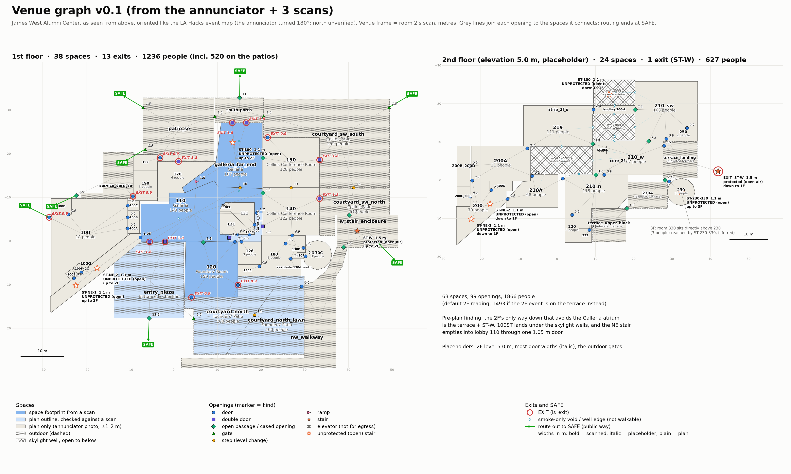

# venue.json: the James West Alumni Center as a graph

`venue.json` is the engine's first building model (schema v0.1). It describes rooms and outdoor areas as **spaces** and every way between them as **openings**. Fire, routes and crowd all read it. It was built from:
- the checked annunciator-plan inventory (`docs/lahacks/venue-plan-inventory.json`);
- the first three scans (`docs/lahacks/10-scan-room1.md`, `11-venue-plan-and-scans.md`).

Where a scan and the plan disagree, the scan wins and the note says so. Values nobody has measured yet are placeholders and are marked as such. The file is meant to be edited by hand.

Today it holds 63 spaces (38 on 1F, 24 on 2F, 1 on 3F) and 99 openings: 14 exits (13 building doors at grade, plus the west exterior stair for the 2F), 5 stairs, 4 steps and a ramp. All 50 indoor spaces reach `SAFE`.



## Frame and datum

- **Units:** metres and seconds.
- **Axes:** Y is up. Plan positions are `[x, z]` in **room 2's scan frame** (the lobby 110 scan), so `room2.glb` drops in with no transform.
- **Elevation 0.0** is lobby 110's finished floor, which is Y −3.91 in room 2's file. Any elevation is room 2's Y + 3.91.
- **Other scans:** rooms 1 and 3 map in with the transforms in `frame.scan_transforms`. They are good to about ±0.3 m near the junction of the three scans.
- **Plan positions:** anything read off the annunciator photo uses `frame.photo_to_venue`: x = −7.5 + (937 − X)/10.4 and z = (539 − Y)/10.4, where X and Y are photo pixels. For the 2F plan, subtract 578 from Y first. Expect ±1–2 m, because the photo was taken at an angle.
- **North is not verified.** If the compass's solid needle is north, north is −z and east is +x.
  - The venue's own names point the other way: the "west" exterior stair and the Collins Room's "west" exits sit at +x, which this reading calls east.
  - So compass words are never resolved. Place lookup (`engine.places`) ignores them in a query and says so, and no `aliases` entry uses one.
- **Polygons** run counter-clockwise in the `[x, z]` plane (positive shoelace area). Seen from above (+Y), where +x is right and +z is down, they look clockwise (`frame.polygon_winding`). The top view from above matches the LA Hacks event map's orientation.

## Fields

**`storeys[]`**
- `id`: `1F`, `2F` or `3F`.
- `elevation`: in m. 2F (5.0) and 3F (8.6) are placeholders; see `source`.
- `source`: where the value came from.

**`spaces[]`**

| Field | Meaning |
|---|---|
| `id` | See the ID rules below |
| `name`, `event_name` | Plain name; the LA Hacks map name, or `null` |
| `aliases` | Optional. Other names people use ("Collins Room", "lobby"), for place lookup. No compass words |
| `kind` | `room`, `lobby`, `corridor`, `restroom`, `elevator`, `closet`, `outdoor` or `open_to_below`. The schema also allows `stair` and `mech`; none are used yet |
| `storey`, `is_outdoor` | Storey id; true for courtyards, patios, plaza, lawn and terraces |
| `polygon` | `[[x, z], …]` in m, counter-clockwise |
| `area` | m², computed from the polygon |
| `floor_elevation` | m above the datum. Nonzero on 1F: the Galleria far end +0.62, 150 and the Collins Patio's south part +0.62 (unverified), the porch +0.62 (assumed), the Founders' lawn −0.6 |
| `height` | Ceiling above the floor, in m. `null` for open-sky outdoor spaces |
| `height_source` | `scan` (measured: 110, the Galleria far end, `corridor_core`, 120) or `placeholder` (3.0 m, including the 2F skylight wells). `null` outdoors |
| `occupant_load`, `occupant_load_source` | People in the default scenario; see the load rules below |
| `detectors` | Alarm-device dots on the annunciator. One symbol covers all device types |
| `geometry_source` | `scan`: footprint measured by a scan. `plan_traced`: plan outline, nudged to scan walls where they exist. `plan_bbox`: rectangle from the plan |
| `scanned_by` | Which scans (`room1`, `room2`, `room3`) cover the space |
| `pin` | Optional `[x, z]`: where place lookup puts the space's pin, on clear scanned floor. Set where the default point inside the polygon lands on furniture or a hole in the scan (`galleria_far_end`, `120`, `150`) |
| `notes` | Free text |

**`openings[]`**

| Field | Meaning |
|---|---|
| `id` | See the ID rules below |
| `a`, `b` | Space ids. `b` may be `SAFE`. On an exit, `a` is the side people leave from |
| `kind` | `door`, `double_door`, `opening`, `gate`, `stair`, `ramp`, `step` or `elevator` |
| `position` | `[x, z]`: the centre of the opening, or the midpoint of the run for a stair or ramp |
| `aliases` | Optional, as for spaces ("main entrance", "stairs to 2nd floor") |
| `ends` | Stairs only, optional: `{space id: [x, z]}`, where the stair meets each space. `ST-100`'s come from room 1's scan, `ST-W`'s from the annunciator (±2 m). Without it both ends use `position` |
| `clear_width` | m |
| `effective_width` | m. Clear width − 0.30 (0.15 m boundary layer each side, SFPE), never below 0. Fixed at **0** for elevators and floor voids: they carry smoke, not people |
| `width_source` | `scan`, `plan` or `placeholder` |
| `is_exit` | True where a storey's occupants leave it: a building door into an **at-grade** outdoor space or `SAFE`, or a protected stair leaving an indoor space or an elevated outdoor space. So on 2F the exit is `ST-W`, not the doors onto the terrace |
| `length` | m, stairs and ramps only, otherwise `null`. For stairs it is the **horizontal walking run**: the larger of the plan run and the code-minimum 7/11 run (0.178 m risers, 0.28 m treads) plus a 1.1 m landing for every 3.66 m of rise. It depends on the 2F placeholder |
| `rise` | m, for stairs, ramps and steps (also set on the elevator shaft); positive means `b` is higher. It matches b's floor minus a's floor to within 0.1 m: 100ST rises 4.38 m from the far end's raised floor, `ST-W` is −5.0 (listed from the terrace down), and the lawn steps' −0.55 is the drop measured at the steps |
| `protected` | For stairs: true if interior smoke can't reach it (an enclosed rated stair, or the open-air west exterior stair); otherwise `null` |
| `notes` | Starts with `INFERRED` when no door is drawn and one was assumed to keep the graph connected. `UNVERIFIED` marks an opening that contradicts the annunciator or rests on an uncertain reading of it |

**`occupant_scenarios[]`** holds the two readings of the event's 2F use. Exactly one has `default: true`, and the spaces' `occupant_load` holds that one. Another scenario lists `overrides` (`{space id: people}`) to swap in.
- `2F_indoor` (default): reading B, with the indoor 2F rooms at assembly density and the terrace empty. 627 people on 2F and 1,866 in all. It is the stress case.
- `2F_terrace`: reading A, with the event on the terrace at assembly density and the indoor rooms at business density. 254 people on 2F and 1,493 in all. The event map's "Northeast Patio" captions favour this reading.

**`landmarks[]`** are points people ask for that are not spaces or openings: `id`, `name`, `kind`, `aliases`, `storey`, `space` (the space it is in), `position` `[x, z]`, `elevation`, `approx_m`, `position_source`, `notes`. Add one only where its position is known from data. Today there is one, the ANN / YOU ARE HERE panel, read off the annunciator. The check-in desk, the stage and the sponsor rows wait until someone confirms them on site.

**`unknowns[]`** lists what the plans and scans don't settle; treat each one conservatively.

Example:
```json
{"id": "S-110-galleria_far_end", "a": "110", "b": "galleria_far_end", "kind": "step",
 "position": [15.2, -12.2], "clear_width": 10.0, "effective_width": 9.7, "width_source": "scan",
 "is_exit": false, "length": null, "rise": 0.62, "protected": null, "notes": "Room 1: 4 risers ..."}
```

## IDs and special nodes

- **Space ids:**
  - the annunciator room number where there is one (`110`, `120`, `200G`);
  - otherwise a stable slug (`galleria_far_end`, `courtyard_north_lawn`, `well_over_110`, `landing_200st`);
  - for a numbered room the plan splits into parts, a suffix: `210_n`, `210_w`, `210_sw`.

  Never reuse or rename an id: routes and fire results key on it.
- **Opening ids:** `<prefix>-<a>-<b>[-n]`. The prefixes are `D` door, `O` opening, `G` gate, `S` step, `R` ramp, `ST` stair, `E` elevator and `V` vertical void or well edge. `OUT` replaces `b` on door exits.
- **`SAFE`:** one sink node for the public way, never a space. Outdoor spaces reach it through `gate` or `opening` edges, sometimes via other outdoor spaces, and those edges are not exits.
- **The 2F terrace** (`terrace_landing`, `230A`, `terrace_upper_block`) is outdoors but **elevated**. It is exit access, not a place of safety. The doors onto it are not exits; the stair down from it (`ST-W`) is.
- **Skylight wells** (`well_over_110`, `well_mid`, `well_200st`) are 2F spaces of kind `open_to_below`. Their `V-` openings are floor voids down to the 1F space below, or well edges at 2F. Both are smoke-only. Routing must skip any edge with `effective_width` 0.

## Using it in the engine

- **End routes at `SAFE`, not at `is_exit`.** Use `is_exit` to count exits and to report clearance per exit. Report time to the exit door and time to `SAFE` separately: several outdoor gates on the way to `SAFE` are placeholders, and they would otherwise headline as the bottleneck.
- **Treat exits as one-way.** Exit doors and outdoor gates carry flow outward only; zero the reverse capacity, or max-flow will route people from the patios back into the building.
- **Split load across parallel openings.** Some pairs of spaces have several openings, for example `D-110-OUT-1`/`-2` and `D-galleria_far_end-OUT-1`/`-2`. Spread the load over them instead of sending a whole room to one door.
- **Stairs:** assume 7/11 geometry unless measured. SFPE then gives a speed k = 1.08 m/s and a maximum specific flow of 1.01 people/s/m, against 1.3 for doors and corridors.
- **Vent areas for the `V-` openings:** use the area of the well polygon over each 1F space (a polygon intersection). `clear_width` on a `V-` edge is only an edge length.

## Widths and occupant loads

**Widths.**
- Scan measurements are used where the docs give them. There are 8: the Founders' opening (4.5), the ANN door frame (1.7), D1 (1.2), the 100G door (1.05), the Galleria step (10.0), the ramp (1.5), the lawn steps (14.0) and the plaza's open court (13.5).
- `plan` widths (23) are used only where the drawing clearly shows the gap, such as open sides, passages between walls, the stair-enclosure gap into the Collins Patio (5.5), well edges and the elevator shaft.
- The other 68 are placeholders:
  - single door 0.9 (40);
  - double door 1.8 (8);
  - gate 1.5 (7);
  - cased opening 1.5 (6);
  - interior stair 1.1 (4) and exterior stair 1.5 (1);
  - elevator door 0.9, with effective width 0 (2).

**Occupant loads.**
- Event capacities (standing, from the venue rental page), split by area where an event area spans several spaces:
  - Galleria 270: `110`, `galleria_far_end`, `corridor_core`
  - Collins Room 250: `140`, `150`
  - Collins Patio 320: both courtyard parts
  - Founders' Room 150: `120`
  - Founders' Patio 200: the paving and the lawn
- Everywhere else, NFPA 101-2021 Table 7.3.1.2:
  - business at 150 ft² (13.94 m²) gross per person, rounded up;
  - event rooms on 2F (default scenario: `210_n`, `210_w`, `210_sw`, `219`, `210A`, `200`): assembly, less concentrated, at 15 ft² (1.39 m²) per person. The table means net area, but it is applied to the gross polygon, which is conservative.
- Zero for restrooms, closets, corridors, landings, elevators, wells and non-event outdoor areas.
- Total in the default scenario: 1,236 on 1F (520 of them on the patios), 627 on 2F, 3 on 3F.

## When a new scan arrives

1. Put it in the venue frame:
   - Align it to a scan it overlaps: click 2–3 shared points, then ICP.
   - Add its transform under `frame.scan_transforms`, with elevation = its Y + offset.
2. For each space it covers:
   - Replace `polygon` with the scan footprint, clipped to walls; recompute `area`.
   - Set `geometry_source: "scan"` and add the scan to `scanned_by`.
   - Replace placeholder `height` (set `height_source: "scan"`) and `floor_elevation` values where the scan measures them.
   - Say in `notes` what changed.
3. For each opening it measures (tape beats scan; scan beats plan):
   - Set `clear_width`, recompute `effective_width`, and set `width_source: "scan"`.
   - Fix `kind` if needed, for example a "door" that is really a cased opening.
   - Drop the `INFERRED` or `UNVERIFIED` prefix once seen.
4. If the scan shows a door the plan lacks, add an opening. If it shows a drawn door is really wall, delete it. Then re-check that every indoor space still reaches `SAFE` (the validation lives with the generator, see below) and remove what is now settled from `unknowns`.
5. If the 2F elevation is measured, update the storey, every stair's `rise` and `length`, the elevator's `rise` and the 3F elevation together.
6. Keep ids stable. If a space must be split, give it new ids and say so in the notes.

Scanning is done and no tape measurements are planned (`docs/lahacks/01-decisions.md`), so these stay placeholders unless a scan already holds the answer. A fourth scan (the Collins Room) was taken but is not folded in yet.

**What would settle the most, if anyone checks on site:**
- the 2F elevation (count risers on the west stair);
- the west stair and its enclosure gate (every `ST-W` evacuee goes through both);
- 100ST and both NE stair flights;
- whether 100G's NE tip has an exterior door, and whether the 100G door is a locked staff door;
- the main entrance and porch door leaves, and 120's two exterior doors;
- the Founders' opening and the ANN door frame;
- the Collins Patio and PATIO fence gates;
- the 140/150 band and the Galleria–Collins openings;
- whether the terrace is outdoors, and which 2F reading the event uses.

## Current unknowns (short form; full list in the file)

- **North:** unverified.
- **Heights:** the 2F (5.0 m, bracket 4.6–5.5) and 3F elevations and every 3.0 m height are placeholders. Every stair rise and length depends on the 2F value.
- **Pre-plan finding:** the 2F has only one way down that avoids the Galleria atrium: the terrace and `ST-W`, which is one placeholder stair and then one placeholder gate.
  - 100ST lands under the skylight wells.
  - Both NE flights empty into 100G, whose only drawn way out is one 1.05 m door into lobby 110.
  - 230 and 330 have a single route.
  - In a Galleria fire the 2F is left with `ST-W` alone.
- **Terrace:** assumed outdoor. Either way it is elevated exit access, not a place of safety.
- **Event 2F use:** unresolved, so both readings are in `occupant_scenarios`. The default is the indoor 2F, the stress case.
- **Openings that may close:** the Founders' opening may be an operable wall. The ANN door frame may hold fire doors that close on alarm. D1 may be a bulkhead.
- **Galleria–Collins openings and the 140/150 step:** unverified.
- **200ST landing:** its door swing is read as the closed strip's door. It could instead be 219's door onto the landing.
- **Stairs:** 100ST and the NE stair are treated as unprotected. Skylight-well edges at 2F are assumed open for smoke.
- **Inferred links:** several doors and links are assumed (notes start `INFERRED`). The space north of 130D is a dead end. The service yard SE of 110 may be indoors.
- **Outdoor routes:** the plaza's route to the public way is not drawn. The Collins Patio west gate and the PATIO east gate are uncertain readings of fence marks. Time to `SAFE` hinges on placeholder gates.
- **No step-free route:** to the lawn, out of the Founders' Patio (site steps up) or out of the PATIO and the service yard (steps down).

*Generator:* `make_venue.py`, `validate_venue.py`, `capacity_summary.py` and `render_venue_graph.py` are in Claude's session scratchpad, in `venue_fix/`. Hand edits to `venue.json` are fine, but re-running the generator would overwrite them.
